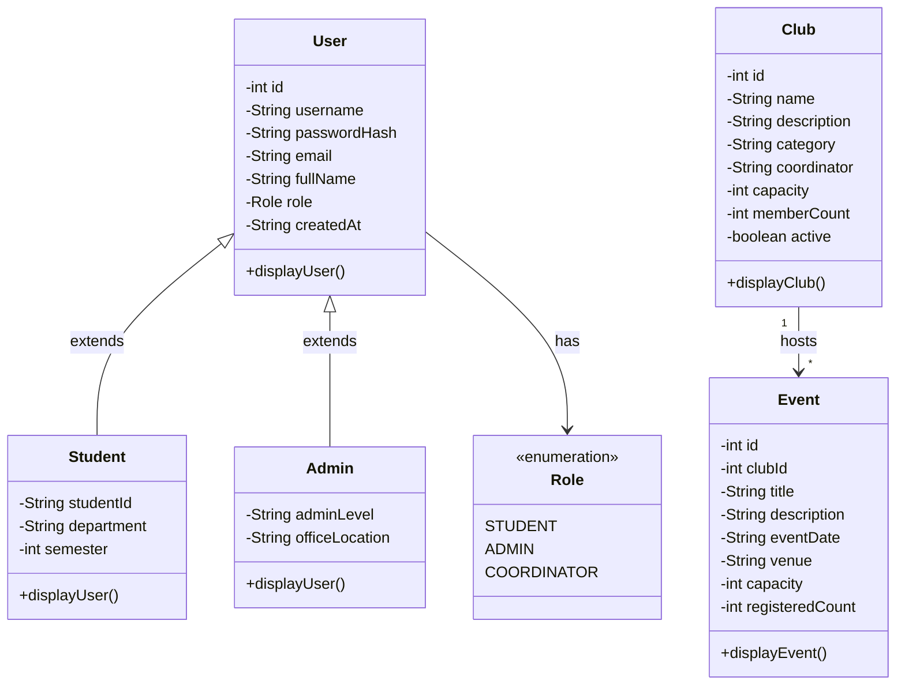

# Phase 1 — Core Application Setup and Design

**Course**: 26MCA1L211 · Java and Web Programming Practical · MCA Semester I  
**Phase Status**: Completed & Verified  
**Git Tag**: `phase-1-complete`

---

## 1. Syllabus Mapping & Objectives

According to the university practical syllabus for **Phase 1 (Core Application Setup and Design)**:
- **Entity Identification**: Identify the core user entity with encapsulated attributes (`username`, `password`).
- **Class Structure**: Establish proper class definitions, default and parameterized constructors, and access methods (getters/setters).
- **Encapsulation & Data Hiding**: Protect sensitive attributes and enforce constraints within entity boundaries.
- **Inheritance & Hierarchy**: Model specialized roles (`Student` and `Admin` extending `User`).
- **Basic String Handling**: Implement custom validation logic utilizing standard Java `java.lang.String` methods (`trim()`, `isEmpty()`, `length()`, `charAt()`) and `Character.isDigit()`.

---

## 2. Preserved Faculty Reference Implementation

To guarantee alignment with faculty lab records and viva questions, the original lab programs are preserved verbatim in package `com.collegeclub.phase1`:

### `com.collegeclub.phase1.User`
- Encapsulates `private String username` and `private String password`.
- Provides default constructor `User()` and parameterized constructor `User(String, String)`.
- Implements `displayUser()` displaying the username.

### `com.collegeclub.phase1.Validation`
- `validateUsername(String username)`:
  - Throws `Exception("Username cannot be empty.")` if `null` or whitespace.
  - Throws `Exception("Username should contain at least 5 characters.")` if trimmed length $< 5$.
- `validatePassword(String password)`:
  - Throws `Exception("Password cannot be empty.")` if `null` or whitespace.
  - Throws `Exception("Password should contain at least 8 characters.")` if length $< 8$.
  - Iterates character-by-character checking `Character.isDigit(c)`. Throws `Exception("Password must contain at least one digit.")` if no digit exists.

### `com.collegeclub.phase1.Main`
- Interactive console application utilizing `java.util.Scanner(System.in)`.
- Programmatic entry point `register(String username, String password)` returning boolean and logging messages.

---

## 3. Enterprise Domain Model Hierarchy (`com.collegeclub.model`)

The production application extends the foundational entities to represent the complete College Club domain:



### Key Object-Oriented Principles Implemented
1. **Encapsulation & Data Hiding**:
   - `passwordHash` replaces plaintext passwords.
   - `displayUser()` prints user metadata but **strictly omits** passwords and password hashes.
   - Setters on `Club` and `Event` perform boundary validation (e.g., minimum name length, capacity bounds).
2. **Inheritance & Polymorphism**:
   - `Student` and `Admin` extend `User`, overriding `displayUser()` using `super.displayUser()` while appending role-specific fields.
3. **Robust Type Safety**:
   - `Role` enum ensures strict compile-time authorization types (`STUDENT`, `ADMIN`, `COORDINATOR`).

---

## 4. Acceptance Verification Results

All acceptance test cases specified by the faculty were executed live:

| Test Case | Inputs | Expected Output | Actual Output | Result |
|-----------|--------|-----------------|---------------|--------|
| **1. Valid Registration** | `sheeja` / `pass1234` | "Registration Successful!" + User display | `Registration Successful!`<br>`--- User Details ---`<br>`Username : sheeja` | **PASS** |
| **2. Short Username** | `abc` / `pass1234` | "Username should contain at least 5 characters." + "Registration Failed." | `Username should contain at least 5 characters.`<br>`Registration Failed.` | **PASS** |
| **3. Missing Digit** | `sheeja` / `password` | "Password must contain at least one digit." + "Registration Failed." | `Password must contain at least one digit.`<br>`Registration Failed.` | **PASS** |
| **4. Empty Username** | `""` / `pass1234` | "Username cannot be empty." + "Registration Failed." | `Username cannot be empty.`<br>`Registration Failed.` | **PASS** |
| **5. Model Hierarchy** | `Student`, `Admin`, `Club`, `Event` | Validation in constructors, password hidden | All 7 JUnit assertions passed | **PASS** |

---

## 5. Execution Commands

### Run Automated Unit Tests (JUnit 5)
```powershell
mvn test
```

### Run Phase 1 Interactive Console Program
```powershell
mvn exec:java "-Dexec.mainClass=com.collegeclub.phase1.Main"
```

### Run Programmatic Registration Examples
```powershell
# Valid registration
mvn exec:java "-Dexec.mainClass=com.collegeclub.phase1.Main" "-Dexec.args=sheeja pass1234" -q

# Short username
mvn exec:java "-Dexec.mainClass=com.collegeclub.phase1.Main" "-Dexec.args=abc pass1234" -q

# Password lacking digit
mvn exec:java "-Dexec.mainClass=com.collegeclub.phase1.Main" "-Dexec.args=sheeja password" -q
```
